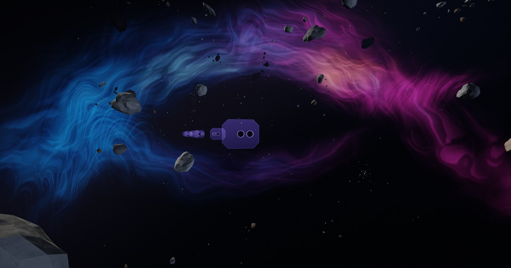

# SoFarAway

> **A hypnotic browser rhythm runner. Thread the gates, ride the beat.**

Vol. I–IV · runtime procedural graphics and music · WebGL2 and Web Audio

[Play SoFarAway](https://sofaraway.librecosta.com/) · [Technical Explorer](https://sofaraway.librecosta.com/debug/)



---

## What it is

You fly through a procedural world while the game synthesizes its soundtrack.
Aim for an opening in each gate. ORBIT also uses gates with two or three legal
openings. Hold Shift to reach the next gate sooner, or choose Sightseeing for
one-third forward speed and the same soundtrack.

Four rhythm-runner courses share the same runtime, steering and rendering pipeline.

| Course | World | Gate families | Soundtrack | Music body | Authored Normal gates | Normal route totals (Main / Challenge / Bonus) |
|---|---|---|---|---:|---:|---:|
| **I · ELSEWHERE** | Octagonal conduit | Iris, Square, Diamond | ELSEWHERE · 128 BPM | 3:30 | 144 | 141 / 145 / 157 |
| **II · DAYBREAK** | Skyglass cabin above a cloud sea | Crystal, Vertical, Horizontal | GLASSHOUSE · 120 BPM | 2:24 | 120 | 120 / 121 / 131 |
| **III · DESCENT** | Industrial facility and vertical well | Matrix 3×3, Slice Gate, Diagonal Weave | CONTROL · 136 BPM | 2:49.4 | 161 | 161 / 161 / 158 |
| **IV · ORBIT** | Asteroid fields and deep space | Single Aperture, Dual Aperture, Triple Aperture | STARWAKE · 128 BPM | 3:00 | 92 | 92 / 93 / 89 |

The authored count is measured before junction replacement. Each route total
includes the gates for that choice after replacement. Encore has its own plan
and count. The music body excludes any release tail.

The soundtrack sets the palette, the light pulses and the spacing of gates.
Your flight speed determines when you cross each gate.

## Play

Play in a browser with WebGL2 and JavaScript enabled. Start a run to hear its
soundtrack. Standard offers Easy, Normal, Hard and Impossible. The menu keeps
Best and Last by volume and difficulty in this browser, including Encore
bonuses in both totals. Runs with gates neutralized during recovery can update
Last. Sightseeing keeps a Last Visit for each volume.

Showcase flies the selected route through the real Impossible course at cruise
speed. The pilot steers through the openings while the soundtrack and scene
play, with the flight HUD, scoring and record writes disabled.

## Run from source

Use Node 24 LTS.

```sh
npm ci
npm run dev
```

For a production preview, run `npm run build` and `npm start`, then open
<http://127.0.0.1:8080>. Any ordinary HTTP static server can serve `build/client`.
Configure the host to return `404.html` with status 404 for unknown paths.
The default INTL artifact is served by Cloudflare Workers Static Assets.
The CN artifact includes the China registration footer and is served by
EdgeOne Pages. See the [verification and hosting guide](docs/verification.md)
for both builds.

### Tests

```sh
npx playwright install chromium
npm run typecheck && npm test
```

The [verification guide](docs/verification.md) lists focused browser, audio,
release and performance checks.

## Controls

| Input | Action |
| --- | --- |
| Mouse / touch drag | Steer — the reticle follows your hand across the whole window |
| Arrow keys / WASD | Steer |
| Hold left button / `Shift` | Boost on desktop |
| `X` | Start · retry |
| Click or tap START | Start |
| `M` | Mute |
| `P` / touch Pause button | Pause or resume |
| `Esc` | Back to menu |

**Immersive Mouse** is off by default. Enable it in Settings on a supported
mouse-capable device to capture the mouse when you start, retry or resume a
flight. Press `Esc` to release the mouse and pause. Settings also offers Enter
and Exit Fullscreen. Immersive Mouse works independently of that control and
with browser fullscreen (`F11`). Browser-native fullscreen prompts can still
appear outside active pointer lock, and their behavior varies across browsers.

On compact touch devices, Settings defaults to a Landscape preference and
also offers Portrait. The game follows the current viewport. When the browser
supports locking orientation, the Fullscreen action applies the preference.
Rotating during flight pauses the run so you can resume from the same position.

## How it is built

React and TypeScript implement the interface, and React Router prerenders the
static site. Three.js and WebGL2 render geometry, materials and textures generated
by the game. Web Audio synthesizes the soundtracks in the browser.
Start at [AGENTS.md](AGENTS.md) for the contribution map and at
[engineering architecture](docs/engineering.md) for the current contracts.

## Technical Explorer

Open `/debug/` directly or follow **Technical Explorer** from **Credits**.
Choose a volume and open a live experiment from its lab. Existing
`/debug/#section` and `/debug/legacy/#section` links redirect to the owning lab.

| Lab | What to inspect |
|---|---|
| `/debug/worlds/` | Fly the four production worlds. ORBIT offers density, seed, station and quality controls, plus AURORA and APHELION inspection. |
| `/debug/gates/` | Rotate production gate families and sample their legal openings. |
| `/debug/lighting/` | Scrub the production lighting scores independently of world station. |
| `/debug/materials/` | Compare lit ELSEWHERE surfaces, raw texture channels and effect specimens. |
| `/debug/gameplay/` | Compare authored charts, route totals, pickups and Encore plans. |
| `/debug/endings/` | Inspect ending presets, spatial motion, music time and results. |
| `/debug/audio/` | Play the four soundtracks with stem waveforms, cues, solo, mute, gain and WAV export. |
| `/debug/interface/` | Inspect production UI states in an isolated frame without changing settings or records. |

For reproducible captures and instrumentation, see the
[Web diagnostics reference](docs/verification.md#web-diagnostics).

## Project status

`dev` is the development branch and `main` is the Web production branch.
[Milestone history](docs/history.md) indexes the technical decisions,
validation evidence and proposals. [Archived screenshots](shots/) show
earlier revisions.

## Credits

Made by **[LibreCosta](https://github.com/librecosta)**.

**Inspiration.** The mechanic is inspired by **HelloRun** (HelloEnjoy, 2013), a
browser game that proved WebGL could be this hypnotic. No code, assets or audio from
it are used here. SoFarAway is an independent work that borrows a design idea and
takes it somewhere else.

## License and security

SoFarAway is licensed under the [BSD 3-Clause License](LICENSE).
The static build includes the project license, the fonts' SIL Open Font
License notices, and the bundled dependencies' third-party notices.

For security reporting, see the [private disclosure contact](SECURITY.md).
