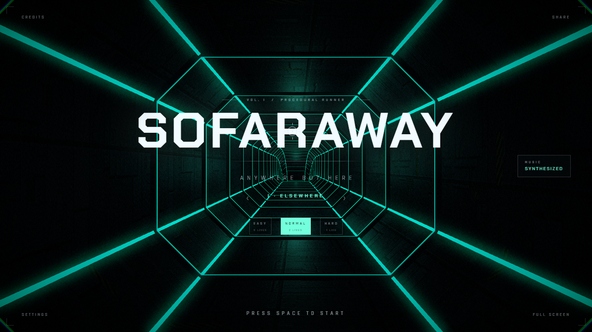

# SoFaraway

> **A hypnotic browser rhythm runner. Thread the gates, ride the beat.**

Vol. I–IV · runtime procedural graphics and music · WebGL2



---

## What it is

You fly down a corridor while the game synthesises its soundtrack. Each glass
gate has exactly one opening. Find it before you reach the gate. Hold Shift to
reach the next gate sooner, or choose Sightseeing for one-third forward speed
and the same soundtrack.

Four volumes. Each is a different corridor, a different kind of glass, and a
different arrangement — but the same engine underneath.

| | World | Glass | Music | Length | Gates (Normal) |
|---|---|---|---|---|---|
| **I · ELSEWHERE** | closed octagonal conduit | **iris** — one of eight radial panes missing · **square** and **diamond** — fixed central openings | techno · 128 | 3:30 | 141 / 145 / 157 (Main / Challenge / Bonus) |
| **II · DRIFT** | open canal, sky above | **shutter** — one of three slats missing, horizontal or vertical | downtempo · 96 | 2:20 | 40 |
| **III · DESCENT** | vertical shaft | **lattice** — one of eight plates missing, centre always solid | industrial · 110 | 3:38 | 158 |
| **IV · ORBIT** | light only, stars behind | **aperture** — one round hole in a full pane | synthwave · 100 | 3:12 | 91 |

The soundtrack sets the palette, the light pulses and the spacing of gates.
Your flight speed determines when you cross each gate.

## Play

Use Node 24 LTS and run:

```sh
npm ci
npm run dev
```

For a production preview, run `npm run build` and `npm start`, then open
<http://127.0.0.1:8080>. Any ordinary HTTP static server can serve `build/client`.
Configure the host to return `404.html` with status 404 for unknown paths.
See the [release readiness report](docs/audits/C0-D-release-readiness-report.md)
for Cloudflare Workers Static Assets and EdgeOne Pages settings.

### Tests

```sh
npx playwright install chromium
npm run test:release
npm test
npm run test:perf
```

The release check runs the strict type check, production build and static-site
smoke tests. Set `RELEASE_CHROMIUM_CHANNEL=chrome` to use installed Chrome.

For the C0-A browser matrix, install the matching browser engines with
`npx playwright install chromium firefox webkit`, then run `npm run test:compat`.
`COMPAT_CHROMIUM_CHANNEL=chrome` selects installed Chrome for both Chromium
projects. See the [C0-A compatibility report](docs/audits/C0-A-compatibility-report.md).

Run `npm run test:stability` for the frame benchmark and the full-song soak.
The [C0-B performance report](docs/audits/C0-B-performance-report.md) documents
the browser requirements and the reference-build comparison.

Run `npm run test:sync` for audio timing, lifecycle, offline signal checks and
real-time songs in Standard and Sightseeing. See the [C0-C audio sync report](docs/audits/C0-C-audio-sync-report.md)
for browser setup and the listening checklist.

Set `A0_BROWSER_CHANNEL=chrome` to use installed Chrome for a comparable GPU
sample. To rerun the original suite against the A0 baseline, run
`git worktree add --detach ../sofaraway-a0 88a4adb`, set `A0_APP_ROOT` to the
baseline worktree's absolute path, then run `npm run test:a0` and
`npm run test:a0:perf`. See the [A0 audit](docs/audits/A0-audit-report.md) and the
[B0 regression report](docs/audits/B0-regression-report.md).

## Controls

| Input | Action |
| --- | --- |
| Mouse / touch drag | Steer — the reticle follows your hand across the whole window |
| Arrow keys / WASD | Steer |
| Hold left button / `Shift` | Boost on desktop |
| `Space` / `Enter` | Start · retry |
| `M` | Mute |
| `P` / touch Pause button | Pause or resume |
| `Esc` | Back to menu |
| `R` | Flight recorder overlay · `Shift+R` downloads the log |

## How it is built

React Router Framework Mode prerenders the menu. After hydration, React sends
commands to the runtime and subscribes to immutable snapshots for the UI. Three.js
and Web Audio are initialized in the browser.

The runtime uses a monotonic timeline for the 60 Hz simulation and aligns the
audio scheduler to that timeline. A reference trajectory converts authored
beats into fixed world positions. Collision and scoring use the player's
actual crossings. Rendering can run at a different rate from simulation ticks;
short stalls catch up in bounded batches.

The graphics session samples a shared path for the camera, procedural tunnel
chunks and GLSL gates. PostFX renders bloom, chromatic aberration, vignette and
grain. High and supported auto profiles add depth of field. The soundtrack is
synthesized in real time.

```text
app/components/    React menu, HUD, settings and results
app/game/runtime/  renderer and audio ownership, sessions, RAF, input
app/game/core/     portable clock, simulation, collision, charts and volumes
app/game/graphics/ procedural scene, tunnel, gates, textures and PostFX
app/game/audio/    Web Audio transport and synthesizer
tests/             Vitest, Playwright and isolated browser harness
build/client/      generated static deployment directory
```

See the [B0 architecture contract](docs/contracts/B0-application-game-runtime-architecture.md)
and the [world-space validation report](docs/audits/D0-B2-F2-validation-report.md).

## Debug overview

Open `/debug/` directly or follow **Debug overview** from **Credits**.
The page renders all four worlds, every gate type and the floating pickups.
**Surface Materials** shows six lit ELSEWHERE samples and their raw channels;
**Effect Materials** shows the cyan light channel and hologram film.
**Soundtrack** exports a WAV for the selected
volume from the same synthesizer. Use `/debug/?vol=orbit#audio` to preselect ORBIT.

### In-game debug parameters

| Param | Effect |
| --- | --- |
| `?vol=drift` | Load a volume (`elsewhere` · `drift` · `descent` · `orbit`) |
| `?t=24.4` | Deterministic — simulate to 24.4 s, then render one frame |
| `?god=1` | Disable collision (on by default in fixed captures, set `god=0` to judge gates) |
| `?align=1` | Steer toward gate openings |
| `?q=low` | Low quality, DPR at most 1, depth of field disabled |
| `?rec=1` | Open the flight recorder |
| `?ui=0` | Hide the UI |
| `?dbg=1` | Read-only timing, draw-call, target and resource diagnostics |

Fixed captures also accept `diff`, `boost`, and `cur`. The game accepts the
existing `post`, `dof`, `panel`, `auto`, and `q=mobile` diagnostics.

## Status

`dev` is the engineering baseline. D0 covers art, music and gameplay polish.
The game generates environment geometry, textures and music at runtime.
Screenshots in `shots/` are for documentation. The release readiness report
lists the remaining device, listening and publication checks.

## Credits

Made by **[librecosta](https://github.com/librecosta)**.

Built with [three.js](https://threejs.org). The game generates its materials,
geometry, textures and notes at runtime.

**Inspiration.** The mechanic is inspired by **HelloRun** (HelloEnjoy, 2013), a
browser game that proved WebGL could be this hypnotic. No code, assets or audio from
it are used here. SoFaraway is an independent work that borrows a design idea and
takes it somewhere else.

## License

SoFarAway is licensed under the [BSD 3-Clause License](LICENSE).
The static build includes the project license, the fonts' SIL Open Font
License notices, and the bundled dependencies' third-party notices.
