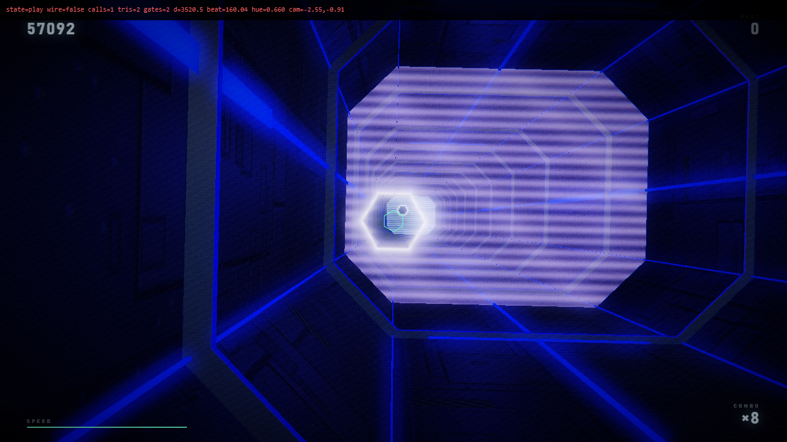

# ELSEWHERE

> **A hypnotic browser rhythm runner. Thread the gates, ride the beat.**

Vol. I · zero assets · zero build step · WebGL2




---

## What it is

You fall forward down an endless corridor at 128 BPM. Holographic gates rush at you —
each one a curtain of scanlines with a single hexagonal opening. Find the opening,
pass through it, keep going.

The world is built from the soundtrack: gates arrive on beat boundaries, the tunnel
pulses on the kick, and the palette shifts every eight bars.

## Play

**Online** → <https://elsewhere.librecosta.com>

**Locally** — it's a static site. Any file server works:

```bash
python -m http.server 8080
```

Then open <http://localhost:8080>.

No `npm install`. No bundler. No asset pipeline. `three.js` is vendored, everything
else is hand-written ES modules.

> ES modules are subject to CORS — opening `index.html` straight off the filesystem
> will not work. Serve it over HTTP.

## Controls

| Input | Action |
| --- | --- |
| Mouse / touch drag | Steer |
| Arrow keys / WASD | Steer |
| `Space` | Start · retry |
| `M` | Mute |
| `Esc` | Back to menu |

## How it works

**The camera never moves.** The tunnel geometry repeats every 3 units, so the whole
group is simply offset by `distance % 3` each frame. Visually indistinguishable from
real forward travel, but the geometry is never rebuilt and nothing is ever recycled.

**Gates are indexed in beats, not metres.** Each gate stores how many beats remain
(`dBeats`) and decrements by `dt × BPM / 60`. The world position is only computed at
render time. That means a gate always arrives exactly on a beat, no matter how the
speed ramps.

**One hexagon definition, two implementations.** The same signed-distance function
exists in GLSL (drawing the hole) and in JS (collision). The shader and the physics
cannot disagree about where the gap is.

**The wireframe menu is one line.** `scene.overrideMaterial = MeshBasicMaterial({ wireframe: true })`
plus a white clear colour and white fog turns the entire scene into the X-ray look
used on the title screen.

**No post-processing library.** A hand-rolled three-pass chain: bright-pass at quarter
resolution → separable Gaussian ×2 → composite with bloom, radial chromatic
aberration, vignette, grain, scanlines, flash and an ACES shoulder.

**The music is synthesized, not loaded.** Drums, bass, pad and arp are scheduled with
a 120 ms lookahead against `AudioContext.currentTime`, and the game clock reads back
from the audio clock so visuals cannot drift.

## Project layout

```
.
├── index.html            entry point + import map
├── css/style.css         menu / HUD / game-over UI
├── vendor/
│   ├── three.module.js   three.js r187
│   └── three.core.js
└── js/
    ├── main.js           state machine, loop, input, camera, collision
    ├── tunnel.js         octagonal corridor: shell, ribs, light strips, rig
    ├── gates.js          holographic gates: hex SDF, scanline shader, drift
    ├── audio.js          procedural soundtrack (Web Audio)
    ├── post.js           blood, sweat and bloom
    └── textures.js       procedural canvas textures: hull, normal, grating
```

## Debug parameters

Useful for screenshots and for poking at the renderer.

| Param | Effect |
| --- | --- |
| `?t=24.4` | Deterministic — simulate to 24.4 s, then render one frame |
| `?align=1` | Auto-align to the nearest gate opening |
| `?god=1` | Disable collision |
| `?q=low` | Lock pixel ratio to 1 |
| `?post=0` | Bypass post-processing |
| `?ui=0` | Hide the UI |
| `?dbg=1` | Draw-call / triangle / state readout |

## Roadmap

- [ ] Vol. II — a second world and a second soundtrack
- [ ] WebGPU path via `three.js` `WebGPURenderer` + TSL
- [ ] Music that builds: intro / drop / breakdown sections per volume
- [ ] Mobile touch tuning
- [ ] Replay ghosts driven by the same beat clock

## Credits

Made by **[librecosta](https://github.com/librecosta)**.

Built with [three.js](https://threejs.org). Every material, shader, texture and note
in this repository is generated at runtime — the project ships no image files and no
audio files.

**Inspiration.** The mechanic is inspired by **HelloRun** (HelloEnjoy, 2013), a
browser game that proved WebGL could be this hypnotic. No code, assets or audio from
it are used here. ELSEWHERE is an independent work that borrows a design idea and
takes it somewhere else.

## License

[MIT](LICENSE)
