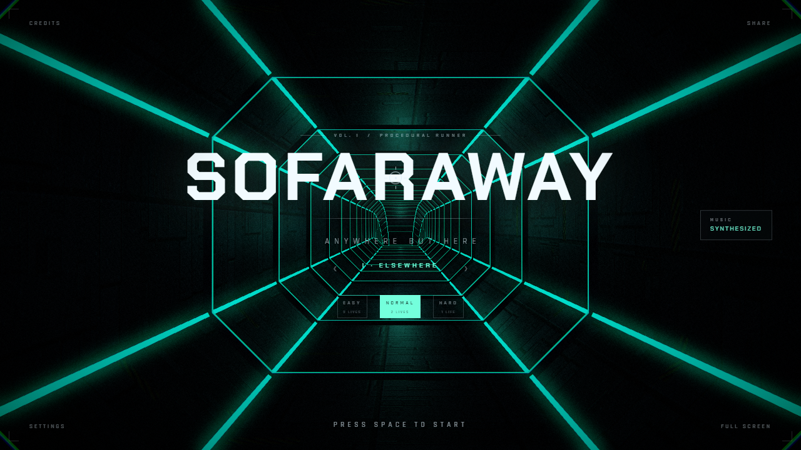

# SoFaraway

> **A hypnotic browser rhythm runner. Thread the gates, ride the beat.**

Vol. I–IV · runtime procedural graphics and music · WebGL2



---

## What it is

You fly through a procedural world while the game synthesizes its soundtrack.
Aim for an opening in each gate. ORBIT also uses gates with two or three legal
openings. Hold Shift to reach the next gate sooner, or choose Sightseeing for
one-third forward speed and the same soundtrack.

Four rhythm-runner courses share the same runtime, steering and rendering pipeline.

| Course | World | Gate families | Soundtrack | Music body | Authored Normal gates | Normal route totals (Main / Challenge / Bonus) |
|---|---|---|---|---:|---:|---:|
| **I · ELSEWHERE** | Octagonal conduit | Iris, Square, Diamond | ELSEWHERE · 128 BPM | 3:30 | 144 | 141 / 145 / 157 |
| **II · DAYBREAK** | Skyglass cabin above a cloud sea | Crystal, Vertical, Horizontal | GLASSHOUSE · 120 BPM | 2:24 | 120 | 120 / 121 / 131 |
| **III · DESCENT** | Industrial facility and vertical well | Matrix 3×3, Slice Gate, Diagonal Weave | CONTROL · 136 BPM | 2:49.4 | 161 | 161 / 161 / 158 |
| **IV · ORBIT** | Asteroid fields and deep space | Single Aperture, Dual Aperture, Triple Aperture | STARWAKE · 128 BPM | 3:00 | 92 | 92 / 93 / 89 |

The authored count is measured before junction replacement. Each route total
includes the gates for that choice after replacement. Encore has its own plan
and count. The music body excludes any release tail.

The soundtrack sets the palette, the light pulses and the spacing of gates.
Your flight speed determines when you cross each gate.

## Play

Use Node 24 LTS and run:

```sh
npm ci
npm run dev
```

For a production preview, run `npm run build` and `npm start`, then open
<http://127.0.0.1:8080>. Any ordinary HTTP static server can serve `build/client`.
Configure the host to return `404.html` with status 404 for unknown paths.
See the [verification and hosting guide](docs/verification.md) for the static
artifact and hosting requirements.

Standard offers Impossible in all four volumes. The menu keeps Best and Last by
volume and difficulty in this browser, including Encore bonuses in both totals.
Sightseeing shows Last Visit per volume.

Showcase flies the selected route through the real Impossible course at cruise
speed. The pilot steers through the openings while the soundtrack and scene
play, without the flight HUD, scoring or record writes.

### Tests

```sh
npx playwright install chromium
npm run typecheck && npm test
```

The [verification guide](docs/verification.md) covers the release smoke tests,
browser matrix, audio, benchmarks and original A0 baseline.

## Controls

| Input | Action |
| --- | --- |
| Mouse / touch drag | Steer — the reticle follows your hand across the whole window |
| Arrow keys / WASD | Steer |
| Hold left button / `Shift` | Boost on desktop |
| `X` | Start · retry |
| Click or tap START | Start |
| `M` | Mute |
| `P` / touch Pause button | Pause or resume |
| `Esc` | Back to menu |
| `R` | Flight recorder overlay · `Shift+R` downloads the log |

## How it is built

React Router prerenders the site. The browser loads a Three.js runtime and
synthesizes the soundtrack with Web Audio. Start with the [contributor guide](AGENTS.md)
or read the [engineering architecture](docs/engineering.md) for runtime boundaries,
timing, spatial crossings and resource ownership.

## Technical Explorer

Open `/debug/` directly or follow **Technical Explorer** from **Credits**.
Choose a volume and open a live experiment from its lab. Existing
`/debug/#section` and `/debug/legacy/#section` links redirect to the owning lab.

| Lab | What to inspect |
|---|---|
| `/debug/worlds/` | Fly the four production worlds. ORBIT offers density, seed, station and quality controls, plus AURORA and APHELION inspection. |
| `/debug/gates/` | Rotate production gate families and sample their legal openings. |
| `/debug/lighting/` | Scrub the production lighting scores independently of world station. |
| `/debug/materials/` | Compare lit ELSEWHERE surfaces, raw texture channels and effect specimens. |
| `/debug/gameplay/` | Compare authored charts, route totals, pickups and Encore plans. |
| `/debug/endings/` | Inspect ending presets, spatial motion, music time and results. |
| `/debug/audio/` | Play the four soundtracks with stem waveforms, cues, solo, mute, gain and WAV export. |
| `/debug/interface/` | Inspect production UI states in an isolated frame without changing settings or records. |

### In-game debug parameters

| Param | Effect |
| --- | --- |
| `?vol=daybreak` | Load a volume (`elsewhere` · `daybreak` · `descent` · `orbit`). Legacy `drift` links still work. |
| `?t=24.4` | Deterministic — simulate to 24.4 s, then render one frame |
| `?god=1` | Disable collision (on by default in fixed captures, set `god=0` to judge gates) |
| `?align=1` | Steer toward gate openings |
| `?q=low` | Low quality, DPR at most 1, depth of field disabled |
| `?rec=1` | Open the flight recorder |
| `?ui=0` | Hide the UI |
| `?lights=true` | Enable Dynamic Lights for a fixed-time capture without changing settings |
| `?dbg=1` | Read-only timing, draw-call, target and resource diagnostics |

Fixed captures also accept `diff`, `mode`, and `route` for difficulty, play
mode and ELSEWHERE branch side. The game also accepts `boost`, `cur`, `post`,
`dof`, `panel`, `auto`, and `q=mobile` diagnostics.

## Status

`dev` is the development branch. Milestone decisions, superseded contracts
and previous validation reports are indexed in [milestone history](docs/history.md).
Screenshots in `shots/` are for documentation.

## Credits

Made by **[librecosta](https://github.com/librecosta)**.

Built with [three.js](https://threejs.org). The game generates its materials,
geometry, textures and notes at runtime.

**Inspiration.** The mechanic is inspired by **HelloRun** (HelloEnjoy, 2013), a
browser game that proved WebGL could be this hypnotic. No code, assets or audio from
it are used here. SoFaraway is an independent work that borrows a design idea and
takes it somewhere else.

## License

SoFarAway is licensed under the [BSD 3-Clause License](LICENSE).
The static build includes the project license, the fonts' SIL Open Font
License notices, and the bundled dependencies' third-party notices.
