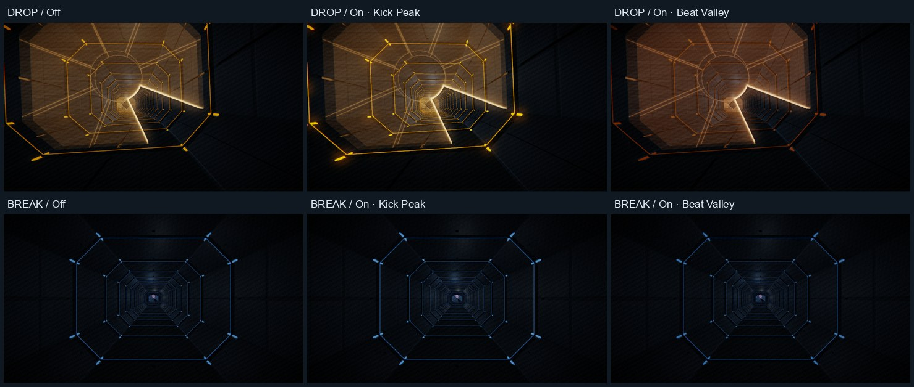

# D0-C1-F1 Dynamic Lights validation

Baseline `7beaadbaf4db788c547b87c34a8e60f0dc482a63`.

## Lighting and synchronization

The old envelope only increased the baseline, peaked about 77 ms after a drum onset, and left the tunnel point lights at their original intensities. Bloom and ACES further compressed the visible change. The new envelope reaches its peak on the authored event after a 16 ms eased lead-in and decays with a 140 ms time constant. It takes the maximum weighted contribution across active drums. A coincident kick and snare can strengthen a quarter-note accent within the same ceiling. Offbeat kicks and fills carry weaker accents, and hats leave the scene lighting alone.

| ELSEWHERE section | Fixture minimum | Fixture peak |
| --- | ---: | ---: |
| INTRO | 0.85× | 1.15× |
| A | 0.50× | 1.70× |
| B | 0.50× | 1.70× |
| BUILD | 0.40× | 1.90× |
| DROP | 0.30× | 2.25× |
| BREAK | 0.80× | 1.20× |
| A2 | 0.50× | 1.75× |
| FINALE | 0.35× | 2.20× |

These bounds describe the envelope before event weighting, the 1.5-beat section blend, BUILD ramp and 16-beat closing taper. The other volumes use the same envelope with their own score and section energy. The switch mixes the result with the original light over 280 ms. Reduced Motion uses the original light, with an explanation in Settings and Beat Inspection.

Tunnel strips and the atlas receive the fixture gain once. Octagonal and branch rims use a gentler range of 0.454–1.80×. Existing point lights use 0.85–1.35× and scenic ambient and hemisphere fill use about 0.93–1.16×. Glass materials and gameplay uniforms keep their original inputs. The existing HDR chain retains its 0.82 bloom threshold, 0.30 soft knee, 0.72 bloom strength and 1.05 ACES exposure.

The scheduler and lighting share the 16th-note grid, song anchor and drum rules. The visual envelope samples the RAF time on the scheduler's output clock when the browser provides a valid timestamp. Silent play and browsers without a usable output timestamp fall back to the run timeline. Pause holds the frame. Recovery samples the current phase. The [Web Audio timestamp](https://www.w3.org/TR/webaudio/#dom-audiocontext-getoutputtimestamp) estimates audio output in browser performance time.

In live Chromium DESCENT, the uncorrected RAF peaks preceded the estimated audio output by about 48–50 ms. The browser reported 10 ms base latency and 40 ms output latency. After using the output timestamp, the three measured peaks fell within 1.87 ms of their scheduled output estimates. The audio anchor was 0.060 s. The unit test also samples the same envelope at 60, 120 and 144 Hz and verifies the peak is within one frame. Device speaker and display presentation latency require physical instrumentation.

| Kick grid time, s | Scheduled audio time, s | RAF time, ms | Estimated audio output, ms | RAF error, ms |
| ---: | ---: | ---: | ---: | ---: |
| 2.181818 | 2.241818 | 3562.8 | 3560.936 | +1.864 |
| 4.363636 | 4.423636 | 5742.1 | 5743.408 | −1.308 |
| 6.545455 | 6.605455 | 7925.4 | 7924.781 | +0.619 |

## Real frames

Open [Beat Inspection](/debug/#beat-inspection), then choose **Open beat inspection**. Start with ELSEWHERE DROP at station 7244.32. Compare **Dynamic Off** and **On** at **Kick Peak**, then try **Beat Valley**, **Snare Peak** or **Play continuously**. The preview holds the station while the music phase advances and runs silently. **Go to beat’s station** moves the camera explicitly. The controls use the game scene, post stack and seeded geometry.

The screenshots were rendered on Windows in Chrome 157.0.8103.78 on AMD Radeon via ANGLE D3D11. The display grid above uses resized High/DPR 1 captures. The test computes linear-sRGB luminance from the original PNG pixels. Normalized ROIs are `(x0,y0,x1,y1)` of `(.673,.511,.723,.566)` for the strip, `(.77,.25,.91,.42)` for the wall, and `(.489,.372,.56,.419)` for the Iris opening edge. Off and Kick Peak share beat 222.

| DROP frame | Strip Y, High | Wall Y, High | Opening edge Y, High |
| --- | ---: | ---: | ---: |
| Off at onset | 0.05529 | 0.003027 | 0.19272 |
| On at onset | 0.11499 | 0.003517 | 0.20344 |
| On at +50 ms | 0.08292 | | |
| On at +140 ms | 0.04366 | | |
| On at +250 ms | 0.02275 | | |
| On at valley | 0.01253 | 0.002855 | 0.16994 |

DROP peak-to-valley contrast was **9.18×** in the strip and **1.23×** on the wall at High/DPR 1. At device DPR 2, High rendered at 1.6× scale with **9.75×** strip contrast, and Low rendered at 1× scale with **8.30×** strip contrast. Both measured **1.23×** on the wall. The opening edge differed by up to +5.8% at the same beat, with the glass input unchanged and nearby lighting contributing to the composite. The DROP peak had zero pixels with all three channels at or above 250. The BREAK scene's whole-frame peak-to-valley ratio was **1.21×**, compared with **1.54×** in DROP. The sequence visibly lifts the strips and rim on the kick while the opening remains readable. The test also captures A, FINALE, the DROP snare and DESCENT and checks repeatability.

With Dynamic Off, eight production frames across the four volumes matched the baseline byte for byte after hiding diagnostic overlays. The samples included ELSEWHERE's early corridor, DROP, BREAK, FINALE and closing fade. Reduced Motion On and Off also matched within the candidate.

## Performance and regression

Three 180-frame High/DPR 1 runs per mode at 960×540 used the stability harness at DROP station 7244.32. Each row gives the median of the three measured percentiles in milliseconds. A separate renderer-only sample includes the draw path and the envelope when enabled. The live audio timestamp read is covered by the synchronization run.

| Mode | CPU P95 | GPU P50 | GPU P95 | RAF interval P95 |
| --- | ---: | ---: | ---: | ---: |
| Baseline Off | 1.60 | 2.38 | 2.56 | 4.30 |
| Candidate Off | 1.50 | 2.23 | 2.67 | 4.30 |
| Candidate On | 1.60 | 2.24 | 2.62 | 4.30 |

All nine runs rendered 54 calls, 68,650 triangles, 14 programs, 18 textures and 20 geometries with no WebGL errors. The Debug canvas retained those resource counts over 520 repeated switch changes. After forced GC, the JavaScript heap was 10.52 MB at the end of warm-up, 11.25 MB after 300 additional changes and 11.33 MB after 500. This measures browser heap over a short run. A separate native WebGL restoration returned to the same station and snare beat, and the restored texture count decreased from 18 to 17.

The main suite covers spatial crossing, the four scores, gate shader openings and glass layers, Sightseeing, Encore and Afterglow, local records and WebGL recovery. The focused audio suite covers offline score boundaries, activation, pause and recovery, scheduler starvation and live beat timing. All seven real-time Chromium tests passed, including the four original songs, DRIFT Sightseeing, and Normal and Impossible sustained Boost through Encore and Afterglow. The compatibility matrix covered desktop Chromium, Firefox and WebKit, plus emulated Android and iPhone. One iPhone WebKit test hit a transient harness module-load error and passed when rerun against the completed build. Playwright WebKit on this Windows host lacks AudioContext, so those cases exercised silent transport.
