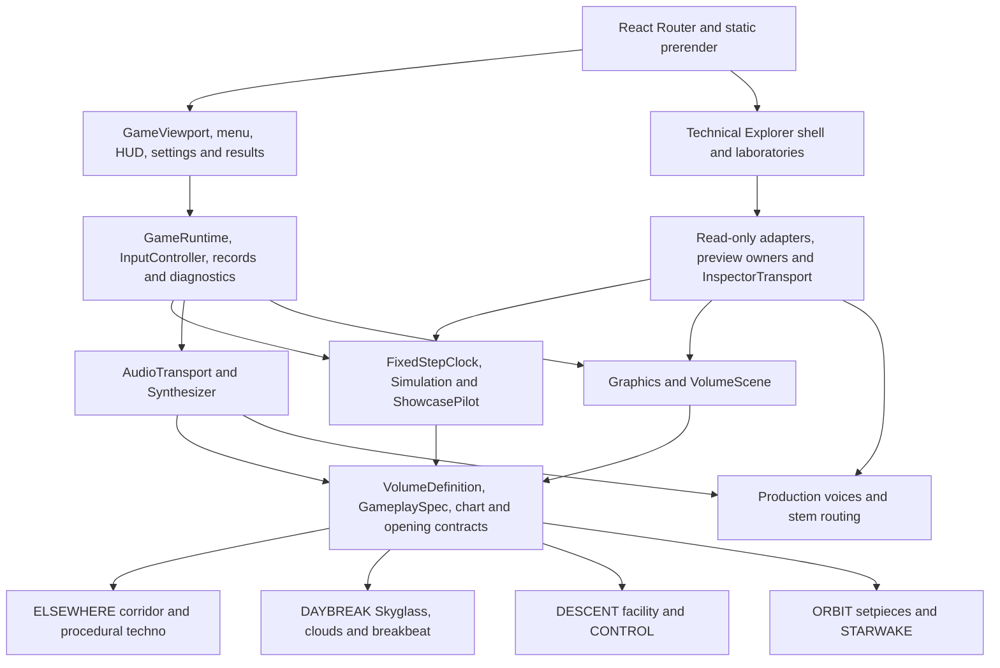

# F4-A Cross-Volume Architecture Audit

Baseline `cf127bf` on `dev`. Scope includes the shipped game, Technical Explorer, tests and static build. This audit changes documentation only.

## Executive Summary

SoFarAway already has one fixed-step engine, one game runtime, one production audio transport and one rendering host. Four authored experiences supply chart, opening, scenery, lighting, score and ending behavior. The strongest boundary is between authored music time and physical world station. The weakest boundaries are run setup and storage, authored-to-runtime chart projection, and ownership of preview rendering surfaces.

- **P0 RECORD-01** reproduces a persisted Best score moving backward under interleaved saves. Fix and verify storage independently of gameplay.
- **P1 RUN-01 and GAME-01** make the effective run policy explicit and put chart selection and spatial projection behind a tested boundary. Preserve live crossing order, routes and authored data.
- **P1 GPU-01** consolidates preview surface ownership where initialization, context recovery and teardown already have the same responsibilities.
- **P2 AUDIO-01** limits audio work to exact scheduling and export primitives. Existing transports, arrangements, room buses and offline render strategies serve distinct purposes.

Use two implementation batches. Establish behavior baselines before changing production call sites. The measurements here cover current behavior and resource scale, and are a starting point for F4 comparisons.

## Current Architecture



- [Routes](../../app/routes.ts) prerender HTML and split Explorer by route. [GameViewport](../../app/components/GameViewport.tsx) loads the browser runtime and subscribes to the [GameSnapshot](../../app/game/contracts.ts) contract. Menu, HUD and results are also reused by the interface preview. The application contains no server-side game loop.
- [GameRuntime](../../app/game/runtime/GameRuntime.client.ts) owns the session and input, audio activation, scheduling RAF, recovery, record writes and publishing. [FixedStepClock](../../app/game/core/clock.ts) consumes elapsed timeline time at 60 Hz. [Simulation](../../app/game/core/simulation.ts) resolves events as the player crosses spatial stations. [ReferenceTrack](../../app/game/core/reference-track.ts) maps authored beats to fixed anchors, with independent live movement.
- [VolumeDefinition](../../app/game/core/volumes.ts) supplies identity, sections, music and topology. [GameplaySpec](../../app/game/core/gameplay.ts) supplies branch, pickup, reference and outro rules. [Opening dispatch](../../app/game/core/collision.ts) connects geometry, collision, Showcase and inspection. [Graphics and VolumeScene](../../app/game/graphics/scene.client.ts) draw and recover a volume using shared camera, gates, post effects and quality infrastructure.
- [AudioTransport](../../app/game/audio/transport.client.ts) owns the production clock and scheduling. [Synthesizer](../../app/game/audio/synthesizer.client.ts) dispatches production voices. [Audio Inspector](../../app/components/audio-inspector/AudioInspector.tsx) uses the voices through its own seekable transport and graph. It also uses offline renderers for analysis and export.
- Explorer has read-only adapters for [gameplay](../../app/game/debug/gameplay-inspection.ts) and [outro](../../app/game/debug/outro-inspection.ts), a [scene adapter](../../app/components/explorer/ScenicLab.tsx), and a separate [specimen renderer](../../app/game/debug/previews.client.ts). [Legacy hashes](../../app/components/explorer/explorer-paths.ts), the `drift` volume alias and the old WAV address are active compatibility contracts.

## Four-Volume Capability Matrix

The final column identifies repeat work and the cost of changing it. The four volume columns describe the current implementations under the named shared entry point.

| Capability and shared entry | ELSEWHERE | DAYBREAK | DESCENT | ORBIT | Consolidation decision and impact |
| --- | --- | --- | --- | --- | --- |
| Chart generation · `chartFor` | Section-driven seeded selection | Authored chapter beats and gate layouts | Facility phrasing and inserts | Authored STARWAKE beats with standard reinforcement | Share dispatch and projection only. Preserve order, kind, sector, axis and inserted flags. |
| Impossible · `difficultySettings`, authored chart providers | Dense chart with generated openings | Dedicated timing and openings | Denser CONTROL chart | Independent 135-gate chart | Share speed policy. Preserve each expanded chart and its timing. |
| Reference motion · `referenceFor`, `ReferenceTrack` | Spatial reference stays at scale 1 for Impossible | Difficulty-scaled reference | Difficulty-scaled reference | Difficulty-scaled skeleton separate from the 92 playable standard gates | Share scalar integration only with parity tests. A reference change moves geometry, gates and junctions. |
| Gate openings · `opening`, `lanePoint` | Iris gaps, square and diamond lanes | Crystal/vertical/horizontal layouts | Matrix/slice/weave axis and opening combinations | Single/dual/triple aperture sets | Existing dispatch is the boundary. Keep geometry and opening shapes specific. |
| Collision · `canPass`, Simulation crossing | Angular or polygonal openings | Skylight gate layout tests | Laser clearance | Elliptical aperture unions | Preserve common judgment and the family-specific mathematical shapes. |
| Branch · `BranchSpec`, `BranchPath` | Corridor S-curve and junction | Skyglass routes | Facility passages | Open-space beacons and flight paths | Share projection and retain authored windows and geometry. Arc length affects actual crossing. |
| Route selection · `branchLayout`, `chooseRoute` | Three semantic routes | Three semantic routes | Three semantic routes | Three semantic routes | Common deterministic side selection is established. Preserve seed mapping and replacement order. |
| Pickup · `GameplaySpec.pickup`, Simulation | Existing fixed corridor position | Fixed Skyglass pickup | Fixed facility cargo | Fixed ORBIT cargo | Pickup definitions already separate placement from collection. Preserve station, lateral offset, preview, deck and rewards. |
| Boost · `Simulation.step`, `ReferenceTrack.boostAt` | Common steering/boost input | Common input | Common input | Common input | An acceleration equation is repeated in live motion and full-boost reference. Share arithmetic only with fixed-tick checks. |
| Encore · `makeOutroPlan`, `outroPhase` | Legacy plan | Defined spacing, gate kinds and reserve | Facility plan and Impossible spacing | Cosmic plan and Impossible spacing | Keep legacy and configured plan semantics. Observe transition and afterglow independently. |
| Ending · Simulation, `GameplaySpec.ending/world` | Corridor escape behavior | Protected white escape and sky | Facility escape | Cosmic ending with no ordinary white escape | Author the effects per volume. Preserve phase ordering and results-world continuity. |
| Camera · `Graphics`, `Path`, `BranchPath` | Corridor bends and bank | Skyglass viewpoints | Facility movement | Open cosmic flight | Camera and coordinate conversion are shared. Keep view composition and route-specific frames. |
| World streaming · `VolumeScene.update` | Corridor chunk window | Cabin and continuous exterior | Facility stages, tunnel and installations | Seeded chunks, instancing and distant setpieces | Reuse ownership conventions only. Visibility, caching, LOD and warmup solve different problems. |
| Dynamic lighting · shared frame input | Lighting atlas and rhythmic score | Sky, exposure and score-driven fixtures | CONTROL cue groups | STARWAKE light rig and celestial cues | Keep cue logic, fixtures and transfer functions specific. Share frame inputs and lifecycle. |
| Materials · `GateVisual`, production material owners | Corridor channels and glass | Skyglass and atmosphere | Facility surfaces and laser materials | Aperture glass, asteroid PBR and cosmic shaders | Common GPU disposal belongs to the owner. Keep actual material definitions and optics. |
| PostFX · `Graphics`, `post.client` | Corridor optics | Sky exposure and escape needs | Industrial optics | Space and celestial layering | Common targets and renderer state. Preserve per-volume direct/post paths and look. |
| Quality · `quality.ts`, Graphics profiles | Corridor resources and scaling | Exterior and cloud detail | Facility draw and lighting budget | Rock density, LOD and cosmic tiers | Share tier negotiation and surface reset. Protect DPR, feature masks and budget choices. |
| Audio scheduling · `AudioTransport` | Grid-only techno | Authored breakbeat | Authored CONTROL | Authored STARWAKE | One production transport. Extract small time-window primitives only if testable. |
| Audio synthesis · `Synthesizer` | Seeded techno voices and master | Breakbeat voices and room | CONTROL voices and buses | STARWAKE voices and continuous room tail | Preserve instrument and mix ownership. Same node API alone is insufficient evidence for consolidation. |
| Score events · volume score and light adapters | Techno grid and rhythmic atlas | Rhythm and layer timelines | CONTROL event sequence | STARWAKE events and cues | Keep arrangement and scene cues. Protect digests and selected rendered audio. |
| Runtime recovery · `GameRuntime` | Common runtime | Common runtime | Common runtime | Common runtime plus specialized prewarm inside Graphics | Preserve activation, pause, catch-up and GPU semantics. Preview recovery has a narrower reusable seam. |
| Showcase · `ShowcasePilot`, production Collision | Cruise-only Impossible | Cruise-only Impossible | Cruise-only Impossible | Cruise-only Impossible | Shared real input and seeded route selection. Keep opening search, rolling plan, no score and no storage. |
| Technical Explorer · `ExplorerLayout`, adapters | Corridor and lighting atlas | Cabin and exterior | Facility stages and lighting | Setpieces and music lighting | Shared shell, query conventions and shader-backed previews. Keep specialized controls and avoid a universal inspector. |

Evidence for the gameplay rows includes [chart dispatch](../../app/game/core/chart.ts), the [volume-specific chart providers](../../app/game/core), [branch contracts](../../app/game/core/branches.ts), [difficulty](../../app/game/core/difficulty.ts), [pickups](../../app/game/core/pickups.ts), [Encore](../../app/game/core/encore.ts) and the [world-space contract](../contracts/D0-B2-F2-world-space-gameplay-graceful-recovery.md). Scene evidence includes [corridor streaming](../../app/game/graphics/tunnel.client.ts), [DAYBREAK exterior](../../app/game/graphics/daybreak-exterior.client.ts), [DESCENT facility](../../app/game/graphics/descent-facility.client.ts) and [ORBIT world](../../app/game/graphics/orbit-world.client.ts).

## Confirmed Duplication Findings

| Evidence | Confirmed overlap and scope | Proposed boundary, expected benefit and risk | Verification |
| --- | --- | --- | --- |
| RUN-01 · P1 | `GameRuntime.start`, `loadVolume`, `capture` and `simulationMode` each assemble portions of requested mode, effective difficulty, seed, scoring and pilot setup. `finishRecord` independently derives persistence from mutable snapshot/options. All four volumes. [Runtime](../../app/game/runtime/GameRuntime.client.ts) | Resolve requested experience into an immutable run policy at each entry point. Derive scoring, pilot and record eligibility from the launched run. Less chance of a preview, retry or future mode inheriting the wrong rules. Medium risk to capture and recovery. | `showcase`, `sightseeing`, `records`, `runtime` and `fidelity` browser suites, plus deterministic policy table. |
| GAME-01 · P1 | `buildChart` and `chartFor` dispatch by the same `volume.music` discriminator. `gameplayFor` also dispatches by volume. Simulation projects authored rows to world and route stations, while `inspectGameplay.gatesFor` separately assembles selected-route rows from Simulation output and `ShowcasePilot` reads those same branch gates for planning. The inspector already reuses computed world stations. The overlapping parts are route-side lookup and route-membership assembly. [Charts](../../app/game/core/chart.ts) · [Gameplay](../../app/game/core/gameplay.ts) · [Simulation](../../app/game/core/simulation.ts) · [Inspector](../../app/game/debug/gameplay-inspection.ts) · [Pilot](../../app/game/core/showcase-pilot.ts) | Select chart providers exhaustively by volume and expose a small, pure run chart projection used by Simulation. Reuse only identical gate/branch projection operations in inspector and pilot. Avoid three interpretations of station, side and opening. High risk at split/rejoin, Impossible speed and Sightseeing neutralization. | Exact chart and spatial fingerprints, route-selection suffix assertions, core `world-space`, `showcase`, `branch` and browser `fidelity` and `explorer-laboratories`. |
| GPU-01 · P1 | `ScenicPreview`, `OutroPreview`, `UIBackdrop` and `OrbitFlightPreview` own Graphics plus context listeners, resize/redraw and disposal. Scenic disposes Graphics when construction throws inside its setup block. Outro allocates Graphics then observes/resizes without the equivalent guard. ORBIT releases and restores via `restoreOrbit`, other preview owners mark lost and use generic `restore`. [Scenic](../../app/game/debug/scenic-preview.client.ts) · [Outro](../../app/game/debug/outro-preview.client.ts) · [Backdrop](../../app/game/debug/ui-backdrop.client.ts) · [ORBIT](../../app/components/OrbitFlightPreview.tsx) | Introduce a small preview surface lifecycle with well-defined ownership transfer and injected restoration/preparation. Preserve scene controls and ORBIT restoration descriptor. Makes rollback and single disposal consistent. Medium-high risk to listeners and prewarm. | Context lost/restore, dispose during loss, fail after renderer acquisition, repeated route changes, `explorer-live`, `outro`, `ui-state-studio`, `orbit-aurora`, `orbit-aphelion` and stability. |
| AUDIO-01 · P2 | Transport and inspector both convert authored step cursors to a finite scheduling window with an end cutoff. They have different seek/resume offsets and tails. Full CONTROL and STARWAKE encoders duplicate stereo 44.1 kHz PCM16 header and seeded dither accounting. Generic WAV export saturates and has different semantics. [Runtime transport](../../app/game/audio/transport.client.ts) · [Inspector transport](../../app/game/debug/audio/inspector-transport.client.ts) · [CONTROL export](../../app/game/audio/descent-export.client.ts) · [STARWAKE export](../../app/game/audio/orbit-export.client.ts) | Consider pure boundary arithmetic and header/dither primitives after byte and onset baselines exist. Keep schedulers, mix graphs, and render/block strategies independent. Low benefit for wrapper deletion alone. High risk to audible tail and export bytes. | `transport.test`, `test:sync`, inspector PCM/stems/seams and full WAV tests, including abort/rejection and second export. |
| CORE-02 · P2 | `ReferenceTrack.boostAt` and `Simulation.step` implement the same boost acceleration response under full boost. Reference integrates canonical authored motion. Simulation also handles user input, turning and run time. [Track](../../app/game/core/reference-track.ts) · [Simulation](../../app/game/core/simulation.ts) | One pure boost response, with independent callers and numeric parity for full boost. Lower risk of movement formula drift. Medium risk to crossings from a rounding change. | Exact pre/post station samples and fixed-tick speed, distance, steering and phase traces. |

## Coupling & Dependency Findings

- **DEP-01 · P2 · all volumes · low risk.** The source import graph covers 287 tracked TS/JS files and 1,456 resolved relative edges, including literal dynamic imports and re-exports. It found zero unresolved relative edges and no strongly connected component among runtime imports. Adding type-only edges yields a 17-file component centered around `contracts.ts`, `VolumeDefinition`, chart, branch and Encore. Keep type edges explicit. Split a domain type only when a new contract reduces its dependencies. Validate typegen, build and static prerender rather than moving files to eliminate harmless type cycles.
- **DEP-02 · Keep Separate.** Core uses pure `Path` and `BranchPath` math currently housed under graphics, and an ORBIT setpiece type reference. No core import of a `.client` module was found. A browser-global candidate in `gameplay.ts` was the local DAYBREAK junction window. Runtime imports `debug/recorder.client.ts` because R/Shift+R are actual player recording controls. Consider moving that module only if changing recorder ownership. No harness direction reversal was found. [Path](../../app/game/graphics/path.ts) · [BranchPath](../../app/game/graphics/branch-path.ts) · [Recorder](../../app/game/debug/recorder.client.ts)
- **TYPE-01 · P2 · all volumes · medium risk.** `GameplaySpec` is registered in a `Partial<Record<VolumeId, ...>>` and `gameplayFor` silently returns `{}` for a missing entry. All four currently have entries. Make registry coverage exhaustive as part of GAME-01, while keeping legitimately optional capabilities such as ORBIT's absence of a white ending. Typecheck and prove current chart, pickup, branch and outro results on each volume.
- **APP-01 · Defer.** `GameViewport` subscribes to Runtime, and the runtime publishes run snapshots plus discrete transitions. It already limits continuous publication and isolates menu-facing consumption. Formatting and mode visibility at UI call sites encode presentation rules. Change only run policy or small identical controls. No evidence justifies a new store, a replacement phase machine or global CSS tokens. Explorer layout, lab styles and audio styles have different scope. [Viewport](../../app/components/GameViewport.tsx) · [Shell](../../app/components/explorer/ExplorerLayout.tsx) · [Lab styles](../../app/styles/explorer-lab.module.css)

## Runtime, Graphics & Audio Assessment

### Runtime and gameplay

**RECORD-01 · P0 · persisted data integrity · all volumes.** [`GameRuntime.finishRecord` at baseline line 545](../../app/game/runtime/GameRuntime.client.ts#L545) does a separate read, mutation and full-document write using [`readRecords`, `recordRun` and `writeRecords`](../../app/game/runtime/records.client.ts). The following deterministic reproduction uses the real record functions with a storage stub. Start with Best 100. Read twice before either write. On snapshot A record 900, and on B record 200 for the same course and difficulty. Write A, then B. A fresh read yields Best 900 after A and Best 200 after B. This models the window at two same-origin tabs finishing close together. The same sequence ran in two Chrome tabs on the same origin against real localStorage, using the production record functions. The original tab also read Best 200 after the second write. The probe controls the interleaving at the storage boundary. It does not claim to synchronize two naturally completed game runs. The failed-write path also sets `recordsSynced` false and bypasses the next fresh read, so a later successful retry can overwrite another tab's newer data.

Make the save operation serialization-aware, reading and reconciling each intended result inside the write boundary. Test real cross-tab transactions on supported browsers. A fallback must be documented according to its actual guarantees. A second read alone cannot guarantee a transaction. Preserve `sofaraway.records.v1`, historical IDs and version parsing, continued play with unavailable storage, recovery Last without Best, Sightseeing Last Visit and Showcase/diagnostic isolation. Protect exactly-once result submission and explicit ordering for Last. A recovery score must never create Best through a merge or through the existing compatibility parser. Benefit is monotonic Best and survival of unrelated volume data across writes. Risk is high because persistence is user data. Existing [record unit tests](../../tests/core/records.test.ts) and [record browser tests](../../tests/browser/records.spec.ts) cover semantics and sequential use. Add stale writers, unrelated entries, failed-then-recovered storage and two-tab coverage.

**RUN-02 · P2 · runtime lifecycle · all volumes.** `start`, `resume`, `restoreAudio`, `release`, surface restoration and page visibility coordinate through generation checks, audio pending state, recovery timers and a single RAF. Keep `GameRuntime` as the owner of these effects. Bundle tests for pending start/resume followed by menu, volume switch, context loss, disposal and BFCache. Move a transition helper only after its preconditions and resource ordering match. `GameRuntime.frame` uses audio output time or wall time to advance the same fixed-step clock, with recovery/neutralization scoped to covered gameplay. `ShowcasePilot` receives ordinary steering inputs, follows safe openings, uses seeded semantic side selection and stays at unboosted Impossible cruise. It cannot inherit God, alignment or recovery neutralization. At cruise the reachable Encore subset is dictated by the production ending. Tests assert which Encore stations were actually reached. [Runtime](../../app/game/runtime/GameRuntime.client.ts) · [Clock](../../app/game/core/clock.ts) · [Showcase tests](../../tests/core/showcase.test.ts)

**GAME-02 · P2 · behavior ownership · all volumes.** `Simulation.start` is the best pure extraction target because it assembles inputs before live events. Keep `step` as the ordered coordinator for motion, pickup, split, Encore and gate crossing, including tie handling and spatial interpolation. Mutating branch selection splices the chosen segment and suffix and remaps Encore along the chosen arc. Isolate score calculation only if new tests can first freeze award order and terminal values. [Simulation](../../app/game/core/simulation.ts) · [Encore](../../app/game/core/encore.ts)

| Volume conditions found | Classification and disposition |
| --- | --- |
| `Simulation.outroPhase` and escape fade, ORBIT | A, real difference. Cosmic transitions and no ordinary White Escape. Preserve the behavior and consider a small named outro policy only when touching this code. |
| `Simulation.step` and `finish` DESCENT coast/settle, ORBIT Sightseeing late-gate trim | B, candidates for existing gameplay policy. Move only with exact phase and chart coverage. |
| `chartFor` and `referenceChartFor` on `volume.music` | C, coincident discriminants repeat selection. Use volume identity and retain ORBIT's reference chart and current difficulty scaling. |
| DAYBREAK authored openings in `Simulation.start`, optional axis resolution and entrance details | A/D, volume rule and local compatibility. Keep selection and seed consumption until the projection is covered. |
| `VolumeScene` exterior, corridor fixture and glass choices, Runtime's audio-following lighting conditions | A/D, mostly visual and audio timing differences. Prefer localized decisions at the owning layer. |
| Run/capture branching for Showcase, eligibility on finish | C, shared setup semantics in RUN-01. Keep differences between diagnostics and a product run. |

### Graphics

**GPU-02 · P2 · all volumes.** `Graphics` owns renderer, profile, targets and context release/restore. `VolumeScene` owns a volume's environment, tunnel, lighting, gate pool and geometry cache. The draw pipeline updates the world and view, selects post/direct output, and prepares ORBIT's astral passes using the appropriate target. The hosts already serve as a useful shared boundary. Avoid extracting chunks or per-volume scene graphs based on file size. Quality selects capabilities and profile, adjusts DPR, and may rebuild targets. Runtime applies adaptive resolution policy. Keep user tiers and scene budgets separate. When refactoring GPU-01, measure allocation/release with toggles, including the direct/post variant and the first visible AURORA and APHELION draws. [Graphics](../../app/game/graphics/scene.client.ts#L450) · [Quality](../../app/game/graphics/quality.ts) · [PostFX](../../app/game/graphics/post.client.ts) · [ORBIT setpieces](../../app/game/graphics/orbit-setpieces.client.ts)

The gate pool gets real opening contracts through `GateVisual` and `GateGeometries`. Geometry caching and disposal belong with the renderer owner, and materials, appearance and opening construction remain family-specific. The same world station drives game collision and drawing through route conversion. Do not simplify this to a generic mesh or remove daylight curves to share the tunnel. ORBIT's streaming and instancing use different keys and visibility from corridor chunks and the continuous DAYBREAK exterior. Preserve fixed hero rock identity, sparse/dense detail, and loaded-warm-active astral lifetimes. [Gates](../../app/game/graphics/gates.client.ts) · [Collision](../../app/game/core/collision.ts) · [ORBIT rocks](../../app/game/graphics/orbit-rocks.client.ts)

### Audio

**AUDIO-02 · P2 · DESCENT offline cleanup · low-medium risk.** `renderDescent` disposes its per-block synth following a successful `startRendering`. If that await rejects, control skips disposal. STARWAKE and the inspector stem path dispose in `finally`. This is a verified control-flow gap, with no observed retained node after a real rejection in this audit. Use fault injection, then consider aligning the cleanup without changing PCM, cancellation semantics or block sizing. [DESCENT export](../../app/game/audio/descent-export.client.ts) · [STARWAKE export](../../app/game/audio/orbit-export.client.ts) · [Stem export](../../app/game/debug/audio/stem-export.client.ts)

All four runtime scores use one transport with a 60 ms lead and a 120/220 ms procedural/authored lookahead. The seeded techno grid and authored DAYBREAK, CONTROL and STARWAKE cursors have distinct resume contracts. Inspector scheduling has a separate seekable clock, mix controls and voice retirement. Its waves, full-track renders and stem renders intentionally have different workloads. DAYBREAK uses block preroll, CONTROL uses a multi-bar block context, and STARWAKE renders the continuous room tail. [Transport](../../app/game/audio/transport.client.ts) · [Voices](../../app/game/audio/synthesizer.client.ts) · [Inspector graph](../../app/game/debug/audio/graph.client.ts) · [Waveforms](../../app/game/debug/audio/waveform.client.ts)

## Code Quality & Dead Code Assessment

- **RNG-01 · P2 · shared math · medium risk.** `chart.mulberry32`, `textures.mulberry` and `orbitRandom` share the same Mulberry32 advancement and output transform after seeding. ORBIT first mixes cell and index into its seed. A pure helper can reduce duplicate integer math and remove the dependency of the [DAYBREAK cloud field](../../app/game/graphics/daybreak-cloud-field.ts) on a canvas-texture module. Keep every caller's seed and draw order. Freeze raw PRNG vectors and compare charts, textures and procedural worlds before adopting it. [Chart RNG](../../app/game/core/chart.ts#L29) · [Texture RNG](../../app/game/graphics/textures.client.ts#L6) · [ORBIT RNG](../../app/game/core/orbit-field.ts#L34)
- **TYPE-02 · P2 · low risk.** The AST scan found zero explicit `any` type nodes and zero TS suppression directives under `app`. Non-null assertions in `Simulation.chooseRoute` and `GameRuntime.loadVolume` depend on initialization and phase guarantees. Prefer narrowing at the projection and run-policy boundaries rather than checks at each read. Use real invalid query, route and lifecycle outcomes to verify the guards. A guarantee preserved by test is more useful than eliminating every assertion.
- **DEAD-01 · P2 · shared graphics · low risk.** A tracked-source name scan followed by exact searches found `makeEmissive`, `makeGrating` and `makeGlow` only at their declarations in [textures.client.ts](../../app/game/graphics/textures.client.ts). No namespace or reflective import into that module reaches them. They are unused generator candidates. Remove in a separate small change only after checking a production build and material fallback. `ENCORE_GATE_COUNT`, `IMPOSSIBLE_ENCORE_COUNT`, `PICKUP_PREVIEW_BEATS` and `apertureClearance` are used within their modules. Those are private-export candidates, not dead behaviors.
- **DEAD-02 · Keep Separate.** All tracked `app/game` modules have at least one resolved importer in the scanned graph. This cannot prove that all branches or exports execute. The scanner does not infer computed paths, framework entries or shader symbol reachability. Keep the [Legacy route](../../app/routes/debug.legacy.tsx), static WAV redirect, prerender routes, browser harnesses and release tooling. Check `app/routes.ts`, assets, tests and docs before deleting anything found by a reference scan.
- **DOC-01 · P2 · public documentation · low risk.** The [README](../../README.md#L25) still lists ORBIT's temporary techno, old gate families and older counts. Its [Explorer section](../../README.md#L82) still says interactive previews live at Legacy. Source and measured fingerprints below are authoritative for F4. Bring these statements into line with the volume catalog and redirects when updating public documentation. Test route examples against the static artifact.
- **BUILD-01 · P2 · build reproducibility · low-medium risk.** Two default runs timed out in React Router prerender, on different routes. A separate identical production build passed. The default browser runner also hit its web-server readiness limit once, while the same servers and tests attached successfully when started explicitly. The observed failures do not establish a route-specific production bug. Capture preview-server startup and request timing if flakiness continues. Leave release infrastructure changes for targeted work.

## Test Coverage & Regression Baseline

### Existing coverage and gaps

| Suite | Existing protection | Best next addition |
| --- | --- | --- |
| `tests/core` | Simulation/collision, charts, Impossible timing, branches and arc length, pickups, Sightseeing, Encore, record parser and ranking, transport arithmetic, world-specific data. ORBIT has exact gate-contract tests. Showcase tests all routes and both side arrangements with real movement. | Check full fingerprints and event-order traces across four volumes. Explicitly sample a gate at the split/rejoin boundaries, a recovery award, and reachable Encore. Add stale writer test and one selected F4-wide snapshot comparison after policy extraction. |
| `tests/browser` | Runtime pause/retry/back-forward, collisions, records, fidelity, four-volume Showcase and visualization checks. Explorer tests live state, production samples, route disposal and context restore. Audio tests export and PCM. | Add delayed-recovery/dispose overlaps when changing those paths. Inject a failure after Graphics is constructed and verify balanced release. Prefer existing context and scene diagnostics to blanket pixel snapshots. |
| `tests/sync` | Fixed step/audio continuity, real browser lifecycle and emitted signal. | Compare authored beat cutoff and exact start/seek/resume onset sequences before any shared helper. Keep late/missed diagnostics separated from offline sample matching. |
| `tests/stability`, `tests/harness` | Production-renderer metrics, deterministic inputs, reference performance comparisons, lifecycle and long-run behavior. | Scope tests to touched scene owners. Assert program/geometry/texture counts after reacquisition and no first-visible new programs. Compare multiple runs on the same GPU. |
| `tests/release`, `tests/browser/compat` | Static metadata and fallbacks, rerun/retry, cache headers and real 404, capability/lifecycle checks where browsers are available. | Require release smoke with routing changes and rerun target browser/device checks for delivery. |

Coverage is strongest where tests assert real gate and route decisions. Counts and image-difference assertions establish scale or visible change but may miss a single edited opening, a selected branch suffix, or timing drift. Per-volume generated fingerprints complement focused semantic assertions. Keep tolerances for browser scheduling and rendered audio distinct from exact integer and source-data comparisons. Explorer tests should prefer actual control state and release over private selectors and absolute timings except where the DOM is the public contract.

### Captured deterministic fingerprints

Authored rows are ordered `[beat, kind, sector, axis ?? null, section, Boolean(inserted)]`, grouped from `chartFor(volume, difficulty)` with its default seed in Easy, Normal, Hard, Impossible order. Hash each volume's nested arrays as UTF-8 `JSON.stringify` using SHA-256. Counts refer to **authored chart rows**. Live route totals reflect window replacement and may differ. In particular, ELSEWHERE Easy has 143 authored rows on this baseline. ORBIT standard difficulties have identical authored content and 92 rows. ORBIT Impossible has 135.

| Volume | E/N/H/I rows | Authored chart SHA-256 | Spatial SHA-256 |
| --- | --- | --- | --- |
| ELSEWHERE | 143 / 144 / 144 / 184 | `0ce6af001eeca5bfa5d1c4fed8033de85dd789b15c8716ccb8daefaa6aea96dd` | `3dba3a376831cc7121c3cc57f3041bb3fea2d020246962e2a3c916727209773f` |
| DAYBREAK | 120 / 120 / 120 / 147 | `8f957421a7536391d9ce978d7a4f44d7de336ddbad15a8d266aaa7d2e4871ef3` | `0d18191e9fb40a6d0d0bdb8acf7ab416be8bfb4e1681a93d0c14639632cb043d` |
| DESCENT | 161 / 161 / 161 / 189 | `91b42c1f759be968470fdc2f3e8913e314884a887eb1cfcdcd21dbdb14c318d7` | `258bc84f825057dac084b9a79c0b5eb6278a47ff306b974f8c8842486c5066e1` |
| ORBIT | 92 / 92 / 92 / 135 | `b109cc72fb719ad500dec603e93f38f834bd735e334e2b2d22b13a067f26dbd2` | `f3c73e6f17c7288c3e53999f8a736ea7eacd3ab045c23700f8e7d13d43bd122e` |

For spatial hashes use `VOLUMES` order, then Standard followed by Sightseeing, then the difficulty order above (Normal only for Sightseeing), then seed 0 and 1. Construct `new Simulation(volume, {}, undefined, mode, difficulty)` and call `start(difficulty, seed, undefined, mode)`. Each case, in serialized order, is:

```text
[volumeId, mode, difficulty, seed, branchLayout(seed),
 [branch.preview, branch.split, branch.open, branch.merge, branch.rejoin],
 [junctionPath.guideStart, junctionPath.split, junctionPath.end],
 mainGates, Object.entries(branchGates), outroPlan.gates, outroPlan.afterglowStart,
 pickupStation, pickupPreviewStation, referenceStations]
```

Each gate row is `[kind, beat, axis, open, inserted ?? false, worldStation, routeStation]`. For reference stations sample `reference.station(min(beat, volume.beats), mode)` for each integer from 0 to `ceil(volume.beats)`. Round station, arc and distance fields with `Math.round(x * 1e6) / 1e6`. Keep object and route order from the production functions. Hash all ten cases for each volume. These hashes freeze startup projections and initial Encore gates. Selected-route suffixes, full afterglow placement, boost trajectories and decision traces need separate guards. [ReferenceTrack](../../app/game/core/reference-track.ts) · [Simulation](../../app/game/core/simulation.ts)

Audio event hashes use the same serialization without rounding. These are score data checks. They complement PCM, onset and bus checks and cannot replace them.

| Source value | SHA-256 |
| --- | --- |
| DAYBREAK `rhythmTimeline()` | `a4601d3fa1ff663cd9da9dc347d4ef0c7ab638f195d91b964cae4de6e98ec476` |
| DAYBREAK `layerTimeline()` | `d6f79949b46bef79c81f50223f378e8655bfdbee744d4becaee52aefec4d0905` |
| CONTROL `controlEvents` | `f8e86927909c642b41a4420ab9cb537d397b560956b7c38e325d1b488052cb7a` |
| STARWAKE `starwakeEvents` | `8057b8deb75e18288f38fe3f2257fd95fc6c60da2263fe70add0d80b2e1f1cb6` |

For ELSEWHERE freeze representative deterministic grid calls and PCM with the existing seeded techno graph, which does not expose an equivalent authored event array. For future rendering changes record seed, station, view, beat, profile, dynamic lighting, first-visible warmup state and renderer diagnostics. Add only versioned scene presets with stable inputs.

### Measurement environment and results

Node 24.22.1 on Windows build 19045, Ryzen 7 5800H. Each Node loop is the median of seven production Impossible Showcase runs per volume, alternating seeds 0/1 and cycling Main/Challenge/Bonus. The setup includes Simulation and ShowcasePilot construction and start with a warm reference cache for most samples. The loop ends at first departure from Playing and omits audio, rendering and the final Results coast. Every sampled course escaped with all main gates passed and full life.

| Volume | Setup median | Fixed-step loop median | Ticks in first sample |
| --- | ---: | ---: | ---: |
| ELSEWHERE | 2.07 ms | 8.81 ms | 12,600 |
| DAYBREAK | 2.67 ms | 4.44 ms | 8,640 |
| DESCENT | 1.39 ms | 5.65 ms | 10,165 |
| ORBIT | 2.75 ms | 5.01 ms | 10,800 |

Static artifact in Chrome 158.0.8127.37, ANGLE AMD Radeon D3D11, 960 × 540, DPR 1. Each row is one deterministic diagnostic render at `/?vol=<id>&q=low&dbg=1&t=<seconds>&align=1` with default mode, difficulty and capture seed. Counters come from `Graphics.metrics()`. These are renderer-info counts, not byte estimates, driver timing or always all render passes. Development server checks returned the same counts. Compare the same capture inputs and global settings when using this as a reference.

| Volume | Seconds | Beat | Distance | Calls | Triangles | Programs | Geometries | Textures |
| --- | ---: | ---: | ---: | ---: | ---: | ---: | ---: | ---: |
| ELSEWHERE | 100 | 213.333 | 7106.192 | 32 | 34,920 | 7 | 20 | 16 |
| DAYBREAK | 70 | 140.000 | 6242.057 | 45 | 39,214 | 11 | 39 | 12 |
| DESCENT | 105 | 238.000 | 7482.335 | 28 | 31,764 | 7 | 22 | 5 |
| ORBIT | 131 | 279.467 | 8090.764 | 89 | 10,884 | 8 | 24 | 7 |

A separate ORBIT run on the static build used a real Start click. At beat 3.45 it reported zero late callbacks, missed steps and silent fallbacks. The P pause/resume cycle incremented `resumes` to 1 with the other counters unchanged. Fifty early-flight RAF intervals measured 4.2 ms P95 and 4.3 ms maximum. These are headless callback intervals. GPU timer execution, device output latency, high-tier GPU budgets and full-song performance were not measured here.

### Checks executed on the baseline

| Check | Outcome |
| --- | --- |
| `npm run typecheck` | Passed with Node 24.22.1. |
| `npm test` | Two attempts each passed 343 Vitest cases in 35 files. The aggregate stopped before browser execution when prerender timed out on `/debug/lighting/` and `/debug/interface/`, respectively. |
| Production and harness builds | Both passed in separate runs. Build the production artifact before the harness because the production build clears their common build root. The static artifact prerendered the game, all nine Explorer pages and the Legacy route. |
| Release Playwright | 6 passed on installed Chrome using `RELEASE_CHROMIUM_CHANNEL=chrome` and the checked-in release config. The first attempt used the missing bundled Chromium binary and ran only the HTTP-only case. |
| Main Playwright selection | 61 distinct focused Chrome cases passed across the assembled runs. The selection includes Explorer navigation, all four live and lighting adapters, specimen and context restore, records, static smoke, production runtime/streaming/recovery, all four Showcase checkpoints, ORBIT astral and lighting checks and four audio cases. |
| Performance and ownership | Three AURORA cold/warm cases and the ORBIT lighting resource check passed. Each first visible AURORA draw used six prewarmed layers and added zero programs or builds. Two Explorer circuits released renderers and active preview audio and returned to Overview with no active contexts. |
| Additional probes | All 40 spatial inputs hashed, four volume Showcase CPU measurements, four Chrome captures, live ORBIT pause/resume diagnostics and a verified two-tab real-storage interleave. |

The main browser runner initially hit web-server readiness. A separately executed production build had cleared the previously built harness, so five initial focused harness cases received 404. A harness rebuild and tests attached to the same servers passed those five cases. In the attached runs the temporary config only used the existing Chrome settings and omitted automatic server startup. The fixture servers were the repository static server on ports 8089/8090 and React Router dev on 8091. Raw logs and probes are under ignored `playwright-report/f4-a/`.

The complete default browser suite, full-song real-time sync, extended stability soak, all-stem PCM comparisons and the Firefox/WebKit matrix were outside the successful F4-A runs. The [F3-D acceptance record](F3-D-explorer-acceptance.md) documents historical same-era Chrome/Firefox coverage and Windows WebKit limitations. In that run DAYBREAK crashed WinCairo on both compared revisions and Audio reported unavailable. This audit did not reproduce those behaviors, test native Safari or attribute them to any new regression.

## Keep Separate

| Preserve | Reason and shared seam |
| --- | --- |
| Four voice sets, arrangements, master chains and instrument identities | Grid techno, DAYBREAK breakbeat, CONTROL and STARWAKE have different event and routing contracts. Keep common node primitives and production AudioTransport. Preserve the continuous STARWAKE room and the authored end boundaries. |
| DAYBREAK cloud sea, structured cirrus and Skyglass | The exterior creates a continuous sky/cabin composition. Share renderer surfaces, camera math and profile negotiation. Leave atmosphere, cloud placement and optical shading with DAYBREAK. |
| DESCENT industrial architecture and CONTROL cues | Facility stage, transfer chamber, branch passages and moving installations drive its form and visibility. Keep its facilities, logical fixture groups and authored ending local. |
| ORBIT asteroid chunks, AURORA and APHELION | Sparse instanced rocks, structured gas slices, giant planet/rings and GPU warmup are separate real constraints. Ownership and diagnostics are reusable. Nebula, gas-giant and streaming algorithms stay in ORBIT. |
| Actual gate geometry and visual style | Iris/polygon, Skyglass openings, laser clearance and aperture unions have different geometry. Keep authoritative opening data and collision dispatch shared at their seam. |
| Four scenic compositions and lighting systems | Corridors, sky, facilities and space have different camera and continuity needs. Keep authored fixtures, exposure, cue curves and scene layouts. |
| Special ending effects and inspection controls | Shared Encore and results transitions coexist with volume-specific release, whiteout, coast and cosmic continuity. Preview the genuine sequence while preserving those distinctions. |
| Separate preview and production clocks, specimen gallery and audio graphs | An editor can seek or inspect one asset while the game advances a physical course. Share verified operations and resources with explicit owners. |

## Prioritized Findings

| Priority | Evidence | Change order |
| --- | --- | --- |
| P0 | RECORD-01 | Protect persisted Best and independent records first. Reproduce on two tabs before calling the fix complete. |
| P1 | RUN-01, GAME-01 | Place fingerprints and fixed-step traces before the run-policy and spatial projection changes. Preserve stable round-trip input and route rules. |
| P1 | GPU-01 | Start with Scenic/Outro surface ownership and failure paths. Adopt ORBIT and Interface only when their restoration behavior is demonstrably equivalent at the owner boundary. |
| P2 | RUN-02, GAME-02, CORE-02, GPU-02 | Improve fault coverage. Extract small operations only when they reduce duplicate behavior or make ownership testable. |
| P2 | AUDIO-01, AUDIO-02 | Fix a proven cleanup gap if fault testing confirms the boundary. Share encoding or schedule arithmetic only with strong comparisons. |
| P2 | DEP-01, TYPE-01, TYPE-02, RNG-01, DEAD-01, DOC-01, BUILD-01 | Tighten the registry with GAME-01. Keep cleanup, docs and toolchain follow-up scoped and reversible. |
| Keep Separate / Defer | DEP-02, DEAD-02, APP-01 | Preserve active compatibility entries, specialized scene owners and separate runtime/inspector responsibilities. Defer a global config, engine rewrite, design-token system and deployment work. |

## Recommended Refactoring Batches

### F4-B · Core & Runtime

**Scope and contract.** Land characterization tests, then RECORD-01 as a separate persistence commit. Follow with a run policy used by `start`, `loadVolume`, `capture` and result eligibility. Keep volume chart selection and pure run chart initialization in a separate commit. Expose small authoritative mapping operations to inspector and pilot only where callers currently need the same operation. Retain `Simulation.step` as the stateful crossing coordinator and `GameRuntime` as the effect owner.

**Protection and risk.** Keep authored charts, the alternate ORBIT reference, Impossible speed, collision data, route charts, pickup placements, ending effects and the fixed 60 Hz contract. Preserve storage key/schema and historical IDs. Establish performance and behavioral comparators before moving code. Validate the regression matrix, with cross-tab races, full run results, all spatial projections and pause/context/BFCache overlap. Run ordinary and recovery saves against a stored pre-F4 fixture.

**Rollback and completion.** Keep each seam in a separate commit so chart and policy changes can be reverted without reverting storage protection. Keep storage backward-readable before and after the change. Complete when exact chart/event and spatial fingerprints match, selected branch state and actual crossings match, Best no longer regresses under the tested transaction order, and complete cruise Showcase coverage passes.

### F4-C · Rendering, Audio & Tooling

**Scope and contract.** Add a reversible preview surface owner around Graphics for setup transaction, resize, context events, redraw and dispose. Use small scene-specific preparation callbacks. Preserve ORBIT's target, seed, density and profile through restore. Keep `ModelPreviews` pooled under its existing owner. Address any proven audio cleanup defect as a separate change. Consider exact pure cutoff/WAV primitives only with positive baseline results and a clear reduction in repeated semantics.

**Protection and risk.** Keep `VolumeScene`, four specialized scenery/lighting implementations, gate geometry, profile decisions, astral prewarm, both transports and the four audio mixes. Check renderer and target lifecycles, first-visible metrics, direct/post paths, quality toggles, complete Explorer route circuits, export failure/cancellation, and pre/post PCM or timing. The principal risks are missed context callbacks, repeat initialization, lost warmup and altered final audio samples.

**Rollback and completion.** Migrate each client independently so a problematic owner can revert to its existing lifecycle. Revert audio independently without asset or schema migration. Complete when recovery preserves the current scene, all owned resources reach baseline after repeated navigation, supported audio exports maintain the existing contract, and same-device timing and resource counters show no material regression. F4-C can be limited to rendering ownership if shared audio changes have no measurable benefit.

## Risks & Verification

The following checks are acceptance gates for the batches, not claims that every check was executed in this audit.

| Area | Frozen contract | Verification and recovery criterion | Applies to |
| --- | --- | --- | --- |
| Gameplay charts and motion | Exact four-volume Standard/Impossible charts and reference stations, field order, speed and Boost | Hash the source and startup projection, compare fixed-step cruise/full Boost trajectories and actual world/route gate crossings. Restore old projection if any authored field or station changes. | GAME-01, CORE-02 |
| Gameplay decisions | Three routes and seed mapping, gate collision, fixed pickups, score, Encore/Afterglow | Compare per-run route, selected suffix, phase trace, opening pass/fail, score, and Encore reachability. Sample equal-station event order and post-merge gates. | GAME-01, GAME-02 |
| Records | `sofaraway.records.v1`, recognized historical IDs, Last/Best/Last Visit, Showcase and recovery policy | Reuse record fixtures, add interleaved two-tab saves and failure/retry. Regression means lost unrelated entries, lower Best, or introducing a saved Showcase. | RECORD-01, RUN-01 |
| Runtime | FixedStepClock 60 Hz, audio-led/silent timing, pause/resume, BFCache, recovery and Showcase cruise | Run fixed-step trace and browser lifecycle checks. Exercise setup/retry/dispose races and audio/context loss. Observe one renderer/RAF and no duplicate finish. | RUN-01, RUN-02 |
| Audio | Score events, scheduling and onset, instrument/master/stem mixes, exports and tails | Compare exact event hashes, authored steps, PCM and encoder bytes on the same browser and sample rate, live pause/resume and isolation. Cancel/offline reject and retry, then dispose. | AUDIO-01, AUDIO-02 |
| Graphics | Layout, LOD and streaming, openings, quality, shader programs and AURORA/APHELION prewarming | Fixed view/seed plus renderer-info, repeat switching and context restore. Measure cold/warm entry for direct and post paths and retain first-visible prewarm counters. | GPU-01, GPU-02 |
| Explorer and static | Nine pages, query and legacy compatibility, real scene and material inspection, resource ownership | Run Explorer navigation + lab suites and static release checks. Open live scenes, change control state, force loss/restore, navigate two circuits, and require no active WebGL or AudioContext at Overview. | GPU-01, GAME-01, BUILD-01 |

## Final Recommendation

Prioritize the record write race, then the smallest effective-run and spatial projection contracts. Make preview ownership the second batch and defer audio consolidation unless parity evidence supports it. Avoid generic world renderers, all-purpose volume configuration, or a migration based on source size. The four worlds already share the mechanisms that require consistency. Keep the art, sound, local rendering algorithms and authored timings at their existing seams.
